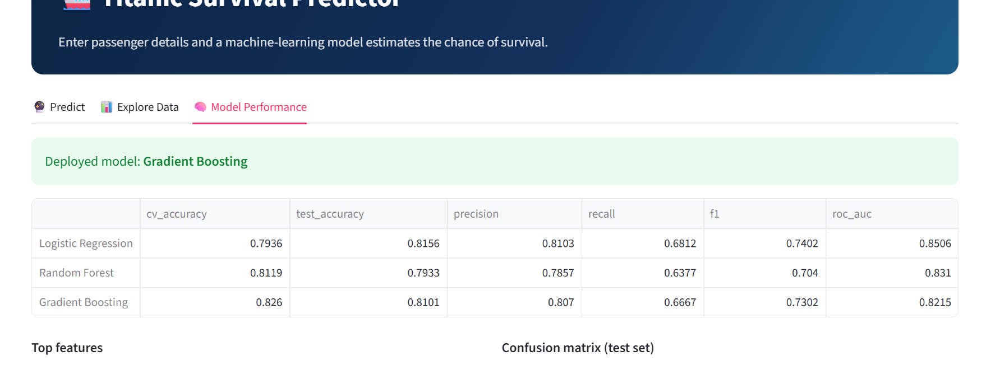

# 🚢 Titanic Survival Prediction — End-to-End ML Project


## 📖 Project Overview

This is a complete, production-ready Machine Learning project that predicts whether a passenger survived the Titanic disaster. 

Unlike basic notebook-only projects, this repository contains a full end-to-end pipeline:
* **Data Processing & EDA** (Jupyter Notebook)
* **Model Training & Tuning** (Logistic Regression, Random Forest, Gradient Boosting)
* **Interactive Web Application** (Streamlit)
* **Dockerized Deployment**
* **Automated Testing** (Pytest)
* **CI/CD Pipeline** (GitHub Actions)

## 🖥️ App Preview




## 🎯 Problem Statement

* **Problem Type:** Supervised Learning → Binary Classification
* **Target Variable:** `Survived` (0 = No, 1 = Yes)
* **Goal:** Predict survival based on features like Passenger Class, Age, Gender, Fare, and Embarkation Port.

## 📂 Project Structure

```text
Titanic/
├── .github/workflows/ci.yml   # GitHub Actions CI pipeline
├── .streamlit/config.toml     # Streamlit UI configuration
├── models/                    # Saved trained models (.pkl)
├── screenshots/               # App screenshots for README
├── tests/test_model.py        # Unit tests for ML pipeline
├── app.py                     # Main Streamlit Web App
├── train_model.py             # Model training script
├── tune_model.py              # Hyperparameter tuning script
├── evaluate_model.py          # Model evaluation & comparison
├── titanic_utils.py           # Helper functions for preprocessing
├── Titanic.ipynb              # EDA & initial experimentation
├── Dockerfile                 # Docker configuration
├── requirements.txt           # Production dependencies
└── requirements-dev.txt       # Development & testing dependencies
```

## 🛠️ Tech Stack

* **Data Analysis:** Pandas, NumPy, Matplotlib, Seaborn
* **Machine Learning:** Scikit-learn, Joblib
* **Web Framework:** Streamlit
* **DevOps:** Docker, GitHub Actions, Pytest

## 🚀 How to Run Locally

### 1. Clone the repository
```bash
git clone https://github.com/your-username/Titanic.git
cd Titanic
```

### 2. Create a virtual environment (Optional but recommended)
```bash
python -m venv venv
source venv/bin/activate  # On Windows: venv\Scripts\activate
```

### 3. Install dependencies
```bash
pip install -r requirements.txt
```

### 4. Run the Streamlit App
```bash
streamlit run app.py
```

## 🐳 How to Run with Docker

If you have Docker installed, you can run the app inside a container without installing dependencies locally.

**1. Build the image:**
```bash
docker build -t titanic-app .
```

**2. Run the container:**
```bash
docker run -p 8501:8501 titanic-app
```
*Open your browser and go to `http://localhost:8501`*

## 🧪 Running Tests

To ensure everything is working perfectly, run the unit tests using `pytest`:
```bash
pip install -r requirements-dev.txt
pytest
```

## 🤖 Model Performance

The models were evaluated using cross-validation and test sets. The best-performing model (**Gradient Boosting**) is deployed in the Streamlit app.

| Model | CV Accuracy | Test Accuracy | F1-Score |
| :--- | :--- | :--- | :--- |
| Logistic Regression | 0.7936 | 0.8156 | 0.7402 |
| Random Forest | 0.8119 | 0.7933 | 0.7040 |
| **Gradient Boosting (Deployed)** | **0.8260** | **0.8101** | **0.7302** |

## 👨‍💻 Author

**ZARFSHAN ATTIQ KHAN**
* 📧 Email: zarfshankahn478@gmail.com
<<<<<<< Updated upstream
* 🐙 GitHub : https://github.com/zarfshankhan/
=======
* 🐙 GitHub :https://github.com/zarfshankhan/
>>>>>>> Stashed changes
